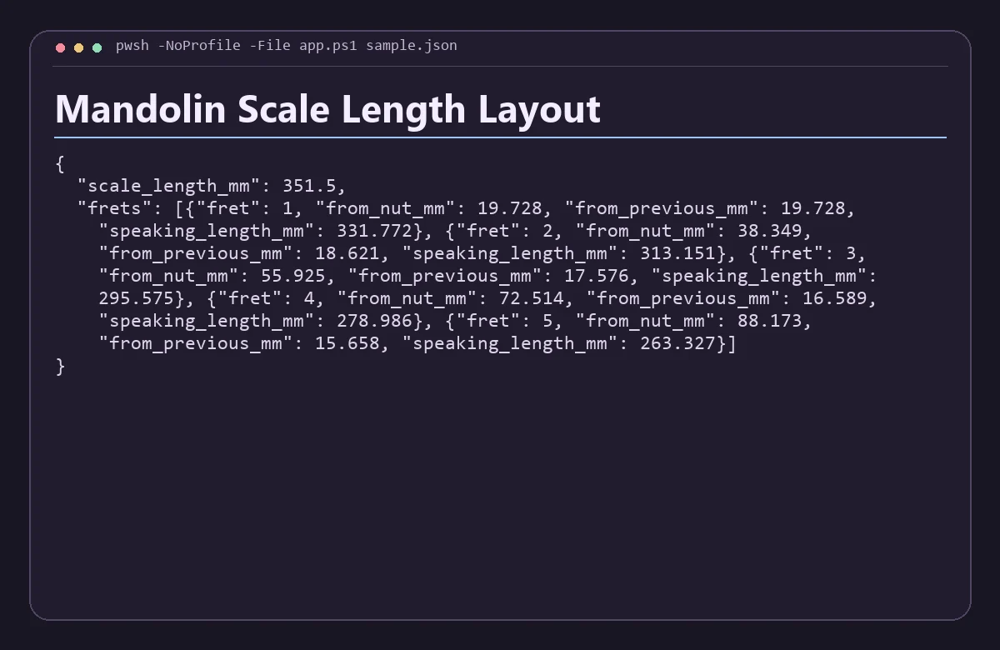

# Mandolin Scale Length Layout

Lay out equal-tempered mandolin frets from a fractional scale length and measure the spacing between successive frets.



## Run

Install PowerShell 7 or newer. Run these commands from the repository root.

```sh
pwsh -NoProfile -File app.ps1 sample.json
```

Replace `sample.json` with a JSON file following the same structure. The app prints a JSON report to standard output.

Supply a positive scale length up to 2,000 mm and an inclusive fret range from 1 to 48. Remaining speaking length is L × 2^(−n/12), measured from fret n to the theoretical bridge position. Spacing is measured from the preceding fret, or the nut for fret 1. Distances are rounded to 0.001 mm after calculation. Bridge compensation depends on the instrument.

## Verify

Run `python check.py` with Python 3.11 or newer after the build step when applicable. The check verifies the bundled scenario and confirms that an invalid input returns an error.
